# Job Finder

**Svenska:** Job Finder är en gratis jobbsökare för Sverige. Välj ort och avstånd, skriv egna sökord (till exempel yrkestitlar, kunskaper eller metoder) och se vilka arbetsgivare som har lediga jobb just nu. Annonserna kommer från Platsbanken och andra svenska jobbsajter. Du kan spara jobb, följa dina ansökningar och skriva anteckningar. Ovanför resultaten visas mässor, konferenser och jobbmässor inom ditt område. Platsbanken-annonser kan översättas till appens språk utan att ditt CV skickas. I steg 2 skriver en AI om hela ditt CV för ett jobb du hittat, färdigt att ladda ner som PDF, eller ett personligt brev eller en intervjuförberedelse. Varje mening visar om den kommer från ditt CV, från annonsen eller är AI:ns egen tolkning, och det som ditt CV inte stöder hålls utanför nedladdningar tills du väljer att behålla det. Mentorn läser ditt CV och föreslår jobb du kan söka och kurser eller certifikat som håller dig eftertraktad, utifrån din erfarenhet och dina planer, aldrig din ålder. Fliken Marknaden visar hur många arbetsgivare inom ditt yrkesområde som annonserar jämfört med för ett år sedan, bredvid de senaste siffrorna för Sverige, och efter några avslag förklarar appen vad siffrorna betyder för dig. Allt sparas i din egen webbläsare. Inget konto, inga kakor, ingen spårning.

**English:** Job Finder is a free job search for Sweden. Pick a place and a distance, add your own keywords (job titles, skills, tools or methods) and see which employers are hiring right now. Ads come from Platsbanken and other Swedish job sites. You can save roles, track your applications and keep notes. Above the results it shows trade fairs, conferences and job fairs in your field. Platsbanken ads can be translated into the app's language without sending your CV. In step 2 an AI rewrites your whole CV for a job you found, ready to download as a PDF, or writes a cover letter or interview prep. Every sentence shows whether it comes from your CV, from the ad or is the AI's own inference, and anything your CV doesn't back up stays out of downloads until you choose to keep it. The Mentor reads your CV and suggests roles to apply for and courses or certificates that keep you in demand, judged by your experience and your plans, never your age. The Market tab shows how many employers in your field are advertising compared with a year ago, next to the latest figures for Sweden, and after a few rejections the app explains what those figures mean for you. Everything stays in your own browser. No account, no cookies, no tracking.

**Try it:** [jmawd.github.io/job-finder](https://jmawd.github.io/job-finder/) (or download `Job Finder.html` and open it in your browser)

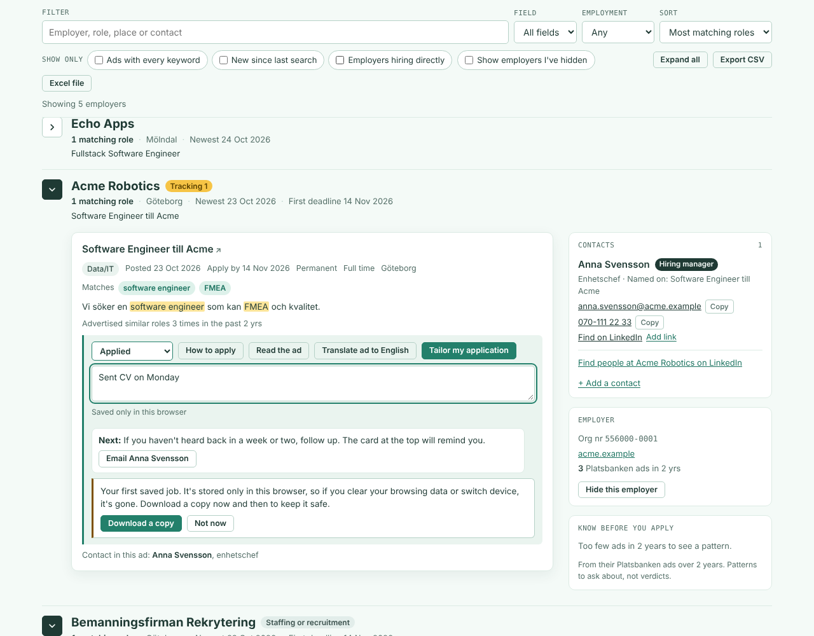

## What it does

- Searches Platsbanken (Arbetsförmedlingen) and other job sites collected by JobTech, such as The Hub and Ledigajobb.
- Place: any of Sweden's 290 municipalities with a distance of 10 to 100 km, a whole county, or the whole country. Gothenburg works as well as Göteborg. Platsbanken's place filters also return ads that only mention the place, such as jobs offered in several cities or travelling nurses for the whole country, so each ad is checked against its own address and those from elsewhere are left out. An ad with an address in the place but its municipality set to somewhere else is shown where the address is.
- Keywords: each one is searched on its own and the results are combined. Tags show which of your keywords each ad actually mentions, and you can keep only ads that mention all of them. An ad mentions a keyword when it uses a plural or definite form of it ("undersköterskor") or, for a longer word, a compound that ends in it ("specialistundersköterska"), as Swedish ads do. A second field leaves out ads with words you don't want, and a word there also leaves out the words it starts: "natt" leaves out "nattpatrull" too.
- When the app switches on Ads with every keyword itself (after splitting a phrase), it holds for that search only and isn't saved as your choice. When filters hide roles, the count under them says which filters and has a Clear filters button.
- A keyword of several words is searched as one exact phrase. If almost no ads in Sweden use that phrase but its parts find plenty, the app offers to split it, so "project leader engineering" becomes "project leader" and "engineering". Real phrases like "project leader" stay together.
- Common job titles written in English also search the word Swedish ads use, so "project manager" brings in ads for "projektledare". The Swedish word shows next to the keyword and can be removed. The list of titles is in `src/titles.txt`.
- Groups the ads by employer, shows the contact people named in the ads, and links to a LinkedIn search for people at the employer. The same ad found on another job site is left out even when the employer's name is written another way ("Helsingborgs stad" for "Helsingborgs kommun"). Each role's snippet starts where your keyword is, not with the employer's introduction.
- Fairs and events in your field: after the first three employers, a panel lists upcoming trade fairs, conferences and job fairs that fit the search, soonest first, with the venue, how far away it is and why it was picked. It reads the calendars of Stockholmsmässan, Kistamässan and Malmömässan, plus job fairs from Visit Sweden's open data near the searched place. An event fits when it mentions one of your keywords, or when it's in the same area of work as most of the ads the search found. Fairs for the general public, school fairs and cancelled events are left out, and in a search for one place so is a trade fair or conference more than 450 km away (Stockholm is too far from Malmö for a day's networking, not from Göteborg). The panel only appears when something fits, and it can be hidden.
- Hiring history: when you open an employer it checks the past two years of Platsbanken ads, so you can see whether that kind of role comes up there regularly.
- Know before you apply: from the same two years of ads, each employer gets a short list of patterns worth asking about. It flags the same job advertised three or more times in a year, hiring that has dropped sharply in the past six months, and employers whose ads are mostly fixed-term, and it shows good signs too, like growing hiring or mostly permanent jobs. Every warning comes with a question to ask in the interview. It's worked out in your browser from the ads alone, with no AI, and isn't shown for staffing firms, whose ads are for other companies. Large employers that post over 60 ads in six months aren't flagged for repeat ads, since the same title coming back is normal there.
- Tracks applications as Saved, Applied, Interview, Offer, Rejected or Not interested, with notes. They stay in My applications when you search for something else. They're stored only in the browser, so the first time you save a job the app suggests downloading a copy, and My applications shows how many changes you've made since your last copy.
- A next step for each status: after applying, a follow-up message to the contact named in the ad, ready to send from your own email; at an interview, a button to interview prep; after a no, a short message asking what made the difference; with an offer, what to get in writing before saying yes. At the top of My applications, plain counts of how it's going: applications sent, interviews or offers, offers, noes and those still waiting.
- Welcome back: when you return after a while, a card at the top tells you how many new Platsbanken ads match your last search since you ran it, with a button that shows just those. It also lists applications that have waited long enough to follow up on (7 days after applying once the deadline has passed, or 14 days whatever the deadline), with a link to email or call the contact named in the ad. Mark a follow-up as done or ask to be reminded in a week. It's all worked out in your browser, with no AI.
- Four parts in one app, in the top bar: Find jobs, My applications, the Market and the Mentor. On a phone they share the width under the logo, each with an icon, so none is hidden off the edge of the screen. After a search on a phone, the form folds into one line ("undersköterska · Skåne län · Edit search") and the filters sit behind a Filter and sort button, so the first employers are on the first screen; it's folded the same way when you come back to saved results.
- When the job ad services don't answer, the results area says why and has a Try again button. Earlier results stay on screen with a note that the new search didn't go through. Above the results it says when they were last checked, and once they're a day old it suggests searching again. Hiring history, the Mentor's open-ad counts and the full ad in step 2 each have their own Try again.
- Feedback during the beta: the footer has a link for each kind of problem (something isn't working, ads are wrong or missing, an AI answer was wrong, an idea, something else). Each opens a new GitHub issue with the app version, language, tab and browser filled in. Nothing from your searches or CV is added, and the page says reports are public. The same link sits next to AI answers and error messages.
- Step 2, tailor my application: each role has a button that opens a panel with the full ad and your CV (paste it or load a Word file). It writes a match check, a tailored CV, a cover letter or interview prep, in Swedish or English. The match check starts with its verdict (strong, reasonable or weak match), and the match check and interview prep are written to you, not about "the person".
- The text comes first: one line above it says how the checks came out ("1 thing not in your CV · 1 sentence held back from downloads · See the checks below") and the full checks follow the text. An answer made from an earlier version of your CV or of the ad says so, with a button to make it again.
- Licences: some jobs need proof from an authority, such as Socialstyrelsen's certificate for the protected title undersköterska (since 1 July 2023) or a licence for nurses and teachers. An exam is not the same thing, and the AI once said it was. When the ad asks for one and your CV doesn't mention one, a note says so, worked out in code whatever the AI wrote, and the AI is told the same.
- The ad's words to pick from: after an answer, the ad's key terms that your CV doesn't use are listed. Pick one only if it's true for you; it starts a line in Anything your CV leaves out? for you to say how, and from then on it counts as yours, so the keyword match can go up honestly.
- How much of the ad there is: when only the listing's short extract came through (an ad on another job site, or a Platsbanken ad that couldn't be fetched), or an ad is longer than the 20,000 characters the AI reads, Generate shows a warning with a way forward instead of an error. Use the visible excerpt goes ahead with what's in the ad box; a long ad is first cut at the end of a paragraph, in the box, so what's sent is what you see. The answer then says it was written from an excerpt, the server tells the model not to guess at the rest, and a fetched ad loses invisible characters and paragraphs repeated word for word.
- The tailored CV is the whole CV, ready to send: your name and contact line, a profile aimed at the job, key skills, every job with its employer and years, your education and the CV's other sections, with nothing else in it. It downloads as a PDF made in your browser (the name large, section headings, each job's years on the right, short lists like key skills in columns, and a clickable email address) or as a Word file, named after you and the employer. The cover letter, 180 to 250 words in three parts (why this job, what you have done that fits, a short close) with no placeholders to fill in, comes with your name and contact line at the top and downloads the same way. Every text can be copied, downloaded as a .txt file or shown as plain text in a box, selected and ready to copy, for a browser where downloads or the clipboard are blocked (if copying fails, the box opens by itself). Edit text lets you change anything before you download; saving runs the fact check and the style check again in your browser, with the server's own code, so a fix or a new mistake shows up straight away. If the AI stopped before the end, or a [bracket] is still waiting to be filled in, the panel says so. Platsbanken ads written in another language than the app also have a Translate button that translates the full ad into the app's language using an access code; it sends only the ad text, never your CV, and translations have their own limit so they don't use up a code's tailoring and Mentor requests. The AI is told never to invent experience that isn't in your CV, and every answer is then checked by plain code: any employer, job title, date, figure, tool or result that your CV doesn't back up is listed in red above the text. Each flag says in plain words what it is ("Number not in your CV: 10") and shows the line it's in. Every answer also has a note above it saying it's an AI draft to check, worded for the task: a tailored CV or cover letter should lose anything you couldn't explain in an interview, the match check is an estimate, and interview prep has likely questions, not the employer's own.
- Where each sentence comes from: every answer comes with a trace, worked out in code, that labels each sentence as from your CV, from the ad, inferred by the AI (mostly its own words, which code can't check) or not in your CV. A line under the fact check counts them, and Show where each sentence comes from marks every sentence in the text with a legend. A sentence that isn't in your CV is marked in place and left out of the PDF, the Word file, the plain text and Copy; a job heading that isn't in your CV takes its lines with it. A list above the text shows what was left out, each with Keep it for something that's true but missing from your CV. Edit text always shows everything.
- Something your CV forgot: under every answer there's a box for true things your CV leaves out, such as a course, a tool you used or a task in one of your jobs. Tailor again with this runs the task again with them at the end of your CV, and the AI is told to put each one where it belongs, like a task under the job it was part of. They're kept for that job only, and the fact check and the sentence trace read them as part of your CV, so they aren't flagged. A line under the box says whether the text on screen used what's in it. Add to my CV for every job moves them into your saved CV instead, for other jobs and the Mentor. Generating again replaces the text, so if you've changed it with Edit text or kept sentences, the app asks first.
- Keyword match and evidence, kept apart: for a tailored CV, a separate line shows how many of the ad's key terms (its names, the words of its title and the longer words it repeats) your CV has and how many this draft has that your CV backs up, with the terms it added and any it dropped. Terms that only the ad has are listed as not counted, so a keyword gain from claiming something you haven't done never looks like an improvement. The evidence line under it counts the sentences by source.
- Mentor: reads your CV once and shows what it read (experience, roles, career stage), then asks four quick questions: how many more years you see yourself working, where you want to go next, how much time you have for learning each week and who pays for courses. It suggests roles in three tiers (apply now, within reach, a change of track) and a learning plan, and sets aside anything that doesn't fit your answers with the reason. Changing an answer re-ranks the advice at once, without a new AI call. Each role shows how many ads are open right now, counted by the role's words together rather than as one exact phrase (ads rarely write "sjuksköterska äldreomsorg" word for word); when those find nothing, its first word is counted and the card says which. Each role has a button that runs the search in Find jobs; each course shows how often its skill is named in recent ads for that role. Career stage comes only from experience and seniority, and the AI is told never to estimate or use age. A note above the roles says the advice comes from an AI that has only read your CV and your four answers, and that course details can be wrong.
- Market: how the job market looks for your field, worked out with no AI. It picks your field (one of Platsbanken's 21 occupation fields) from your applications and searches, and you can change it or pick any county. On the 1st of every month a scheduled job counts the ads published in every field and county over the last three full months and compares them with the same months a year earlier, and the page says whether it's a tough market, slower than last year, about the same or busier, with the open ads on the 1st and how your field compares with the job market as a whole. Below are the latest figures for Sweden: new job postings, unemployment (with Konjunkturinstitutet's forecast), redundancy notices, job openings and ManpowerGroup's hiring outlook, plus figures for the industries closest to your field. Every chart has a table, and each figure shows its source and date. The tab sends no requests of its own.
- After a few rejections: when you mark your third application as Rejected, a pop-up says what the market figures mean for your field, for example that IT ads are down about a quarter on a year ago while unemployment is 8.6%, so even strong candidates hear no more often than usual. It then suggests the Mentor for ideas on becoming a stronger candidate. It comes back after every three more rejections, at most once every two weeks.
- One CV for everything: the Mentor and step 2 read the same copy, saved in your browser.
- Four colour themes, picked with the split circles at the top of Find jobs: seafoam and sunshine, lavender and peach, ocean and mint, or terracotta and sand. One click recolours every view, step 2 and the Mentor, in light and dark mode, and the choice is kept for your next visit.
- Swedish and English, works on phones, exports to CSV and to an Excel file (a CSV opens in one column in Excel set up for Sweden), and lets you download and restore a backup of your saved data, including your CV, tailored texts and the Mentor's advice.

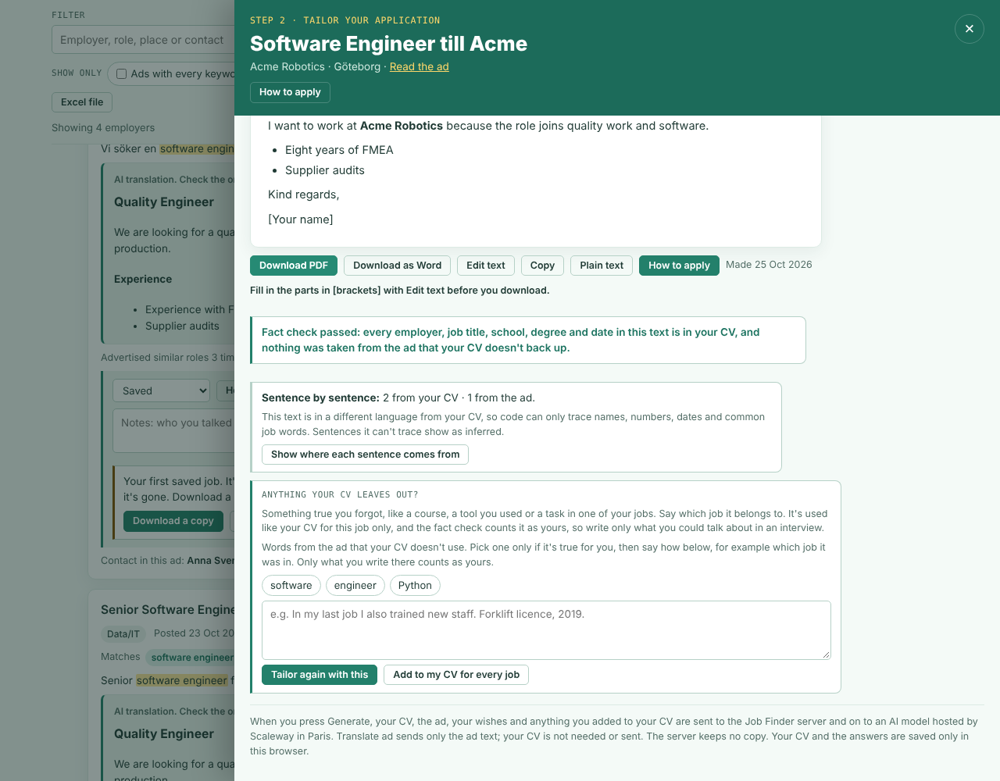

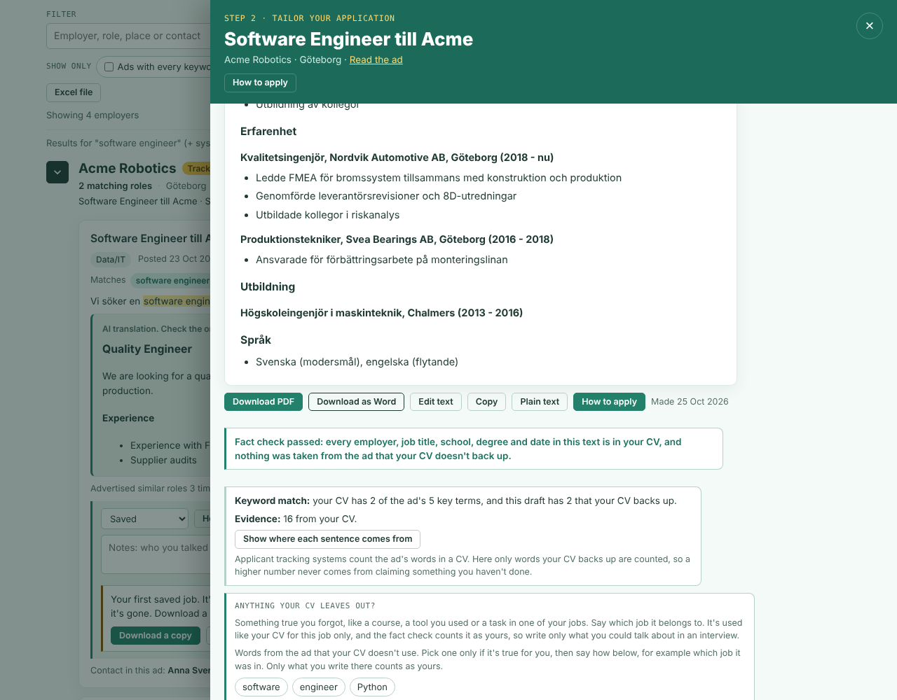

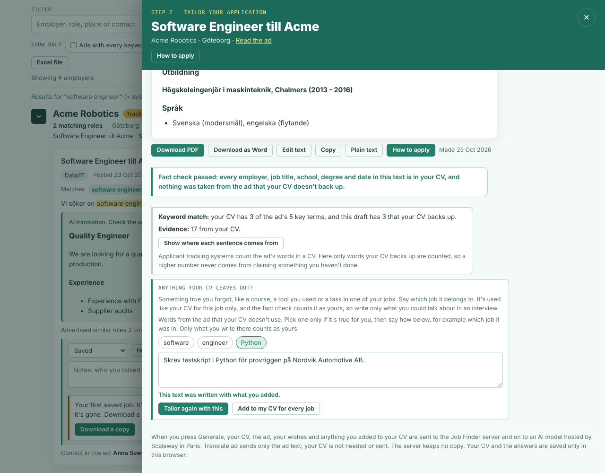

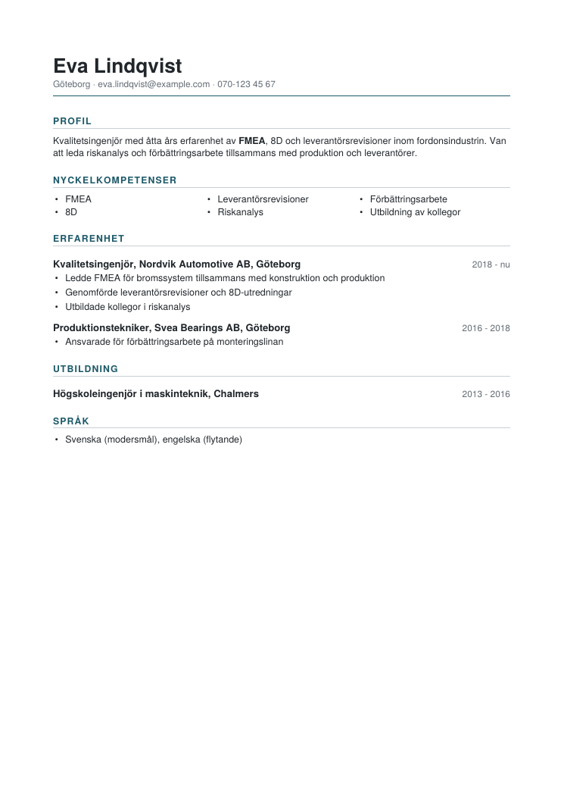

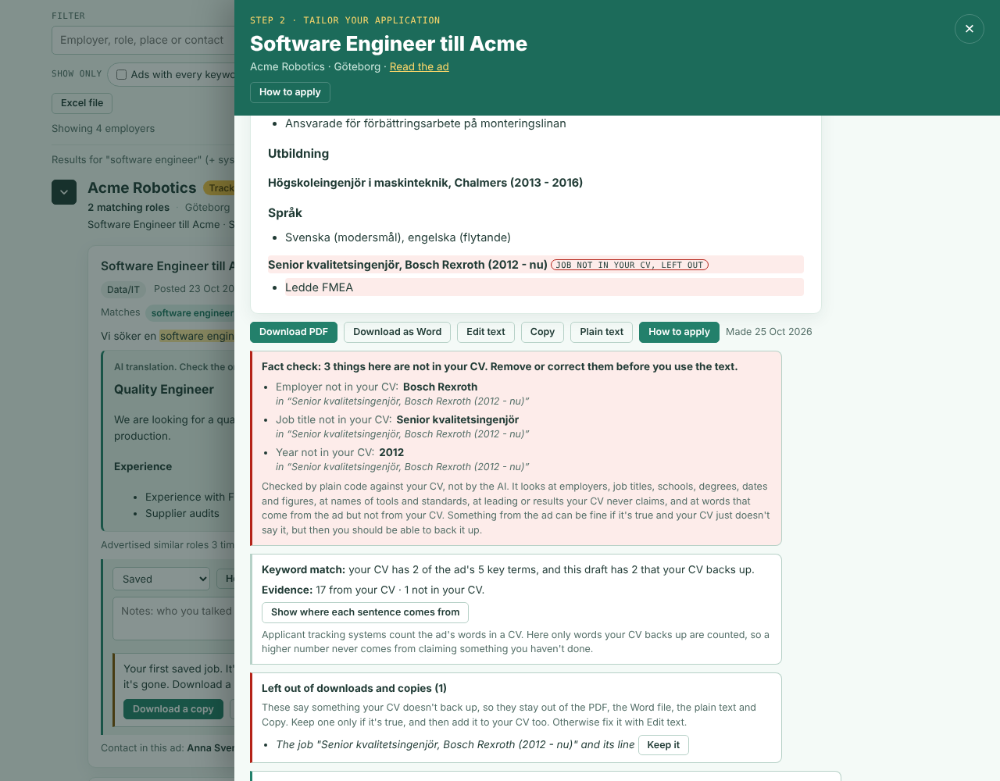

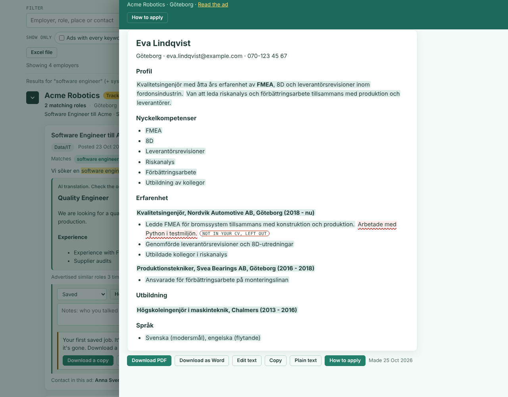

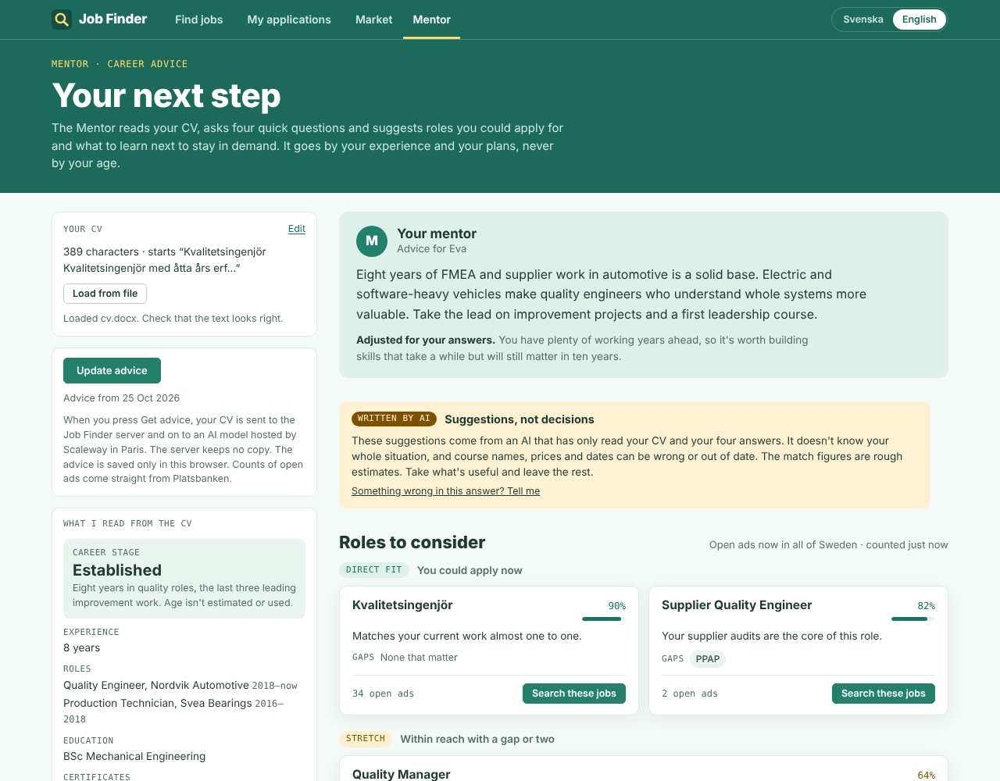

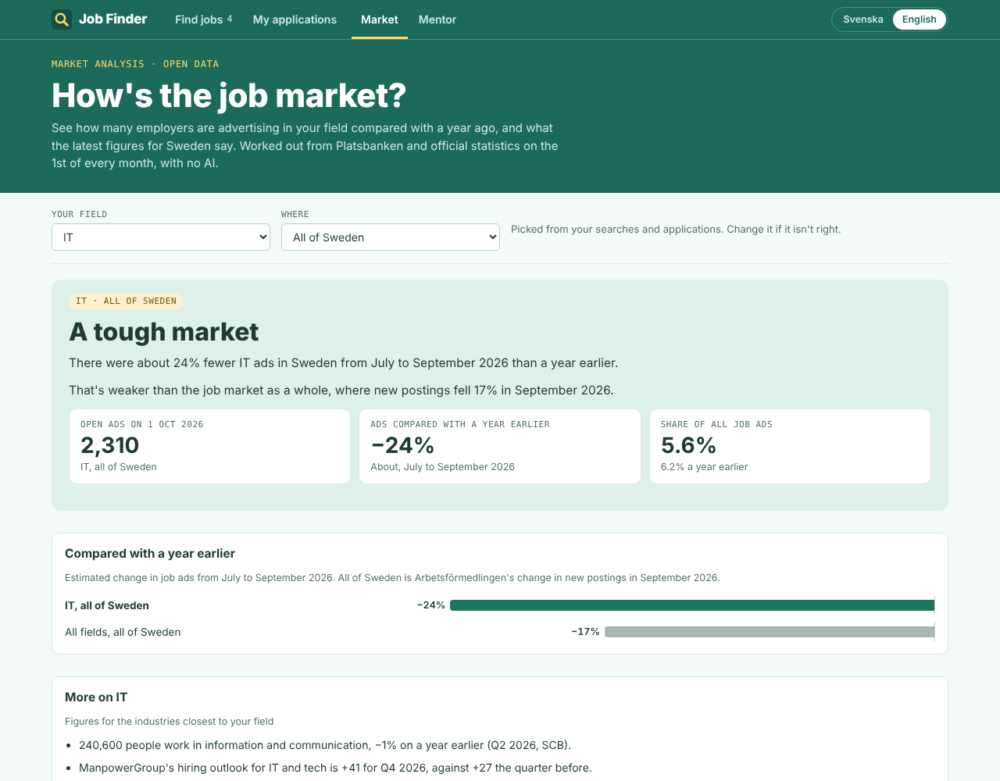

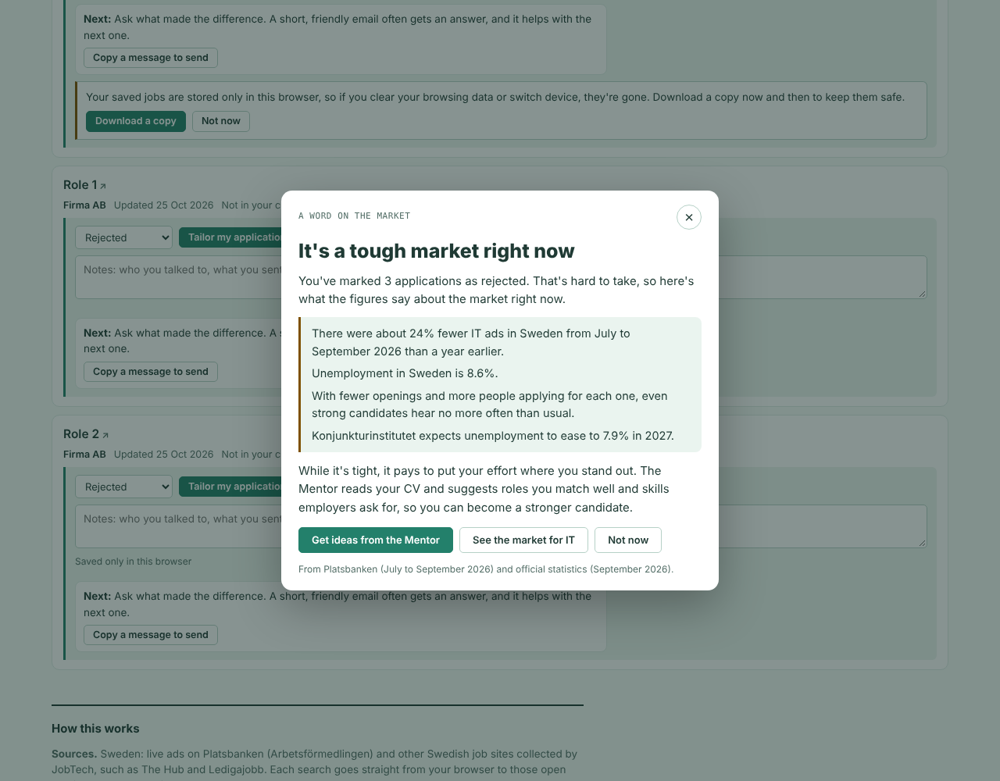

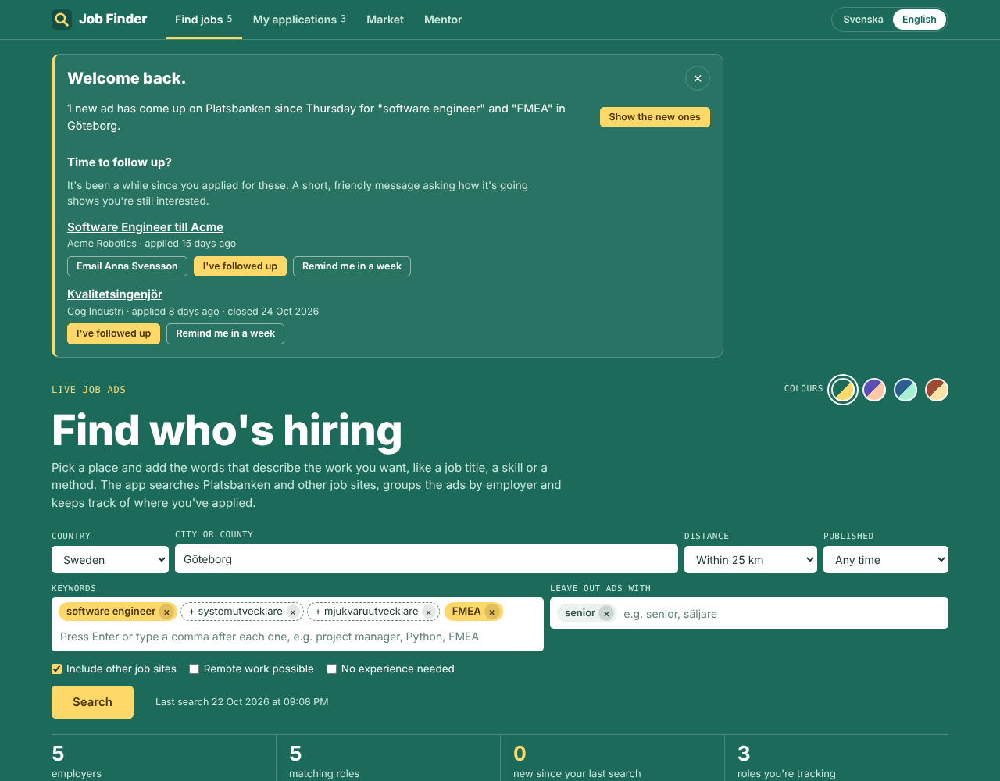

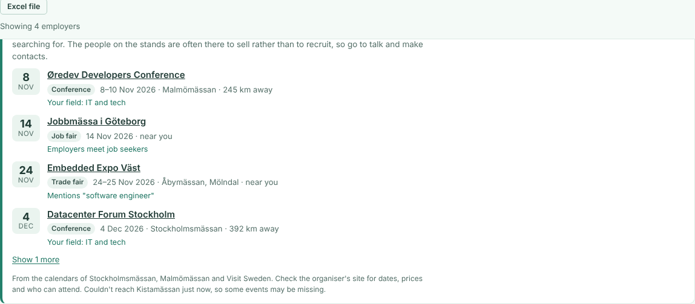

## How it works

The whole app is one HTML file with no server behind it. Searches go straight from the browser to JobTech's open APIs (`jobsearch`, `historical` and `links` at api.jobtechdev.se), which allow requests from any web page. Saved roles, notes and contacts are kept in the browser's local storage.

Fairs and events come from the venues' own calendar APIs (Stockholmsmässan's WordPress events calendar, Kistamässan's and Malmömässan's WordPress event lists) and Visit Sweden's national API at data.visitsweden.com, which all allow requests from any web page. The app downloads each calendar whole and matches it in the browser, so no search words are sent to them, and keeps them for 12 hours. These aren't documented public APIs, so a calendar that stops answering is left out with a note, and the rest still work. Svenska Mässan and Elmia couldn't be read from a web page when this was built.

The PDF of a tailored CV or cover letter is written in the browser by `pdfBlob` in `src/tailor.js`, with no library and nothing sent anywhere. It uses Helvetica, which every PDF reader has built in, so no font is embedded and a one-page CV is about 6 KB. Those fonts cover Swedish and the other Western European letters; a character they can't draw becomes "?", and the panel says how many so you can use the Word file instead.

To find a place, the app asks Platsbanken for ads in that place and reads their location ids and coordinates, so it needs no separate map service.

Step 2 and the Mentor need a small server, because an AI model can't be called safely from a public web page. `server/` is one Scaleway Serverless Function (Node 22) in Paris. The browser sends a beta access code; ad translation sends only the ad text, application-writing tasks send the CV and ad (and anything the person added under an answer that the CV leaves out), and the Mentor sends only the CV. The function checks the code, limits how often each code can be used, adds its own instructions (so the codes unlock these specific tasks, not a general chatbot) and asks an EU-hosted model through Scaleway Generative APIs. For the Mentor the model answers with JSON: a pool of roles and courses with hours, costs and which directions they suit. The browser checks that answer, ranks it against the four answers and counts open ads for each role straight from JobTech. Before a written answer goes back, the function runs a fact check on it (`server/factcheck.js`, see below) and adds the sentence trace and, for a CV, the keyword match. An ad longer than 20,000 characters is cut at a paragraph and the answer says so, and a short excerpt is accepted when the browser says the person chose to go ahead with it. The function logs only sizes, timings and counts (how many things the check flagged, sentences by source, key terms), never the CV, the ad or the flagged words. Setup steps are in [server/SETUP.md](server/SETUP.md). Without a server address in `config.json`, the app is built without step 2 and the Mentor.

### Writing like a person

The rules for how the AI writes come from Job Tailor, where they were worked out first. A CV that reads as machine written works against the person sending it, so every written answer is asked to avoid the usual giveaways:

- **No dashes as punctuation.** Em dashes and en dashes in the middle of a sentence are one of the clearest signs of machine writing. A comma, a full stop or brackets instead; a dash in a date range is fine.
- **Uneven jobs.** A real CV is lopsided. The job closest to the ad gets four to six bullets, a middling one two or three, and the oldest or least relevant may be just its heading line. Never the same number of bullets for every job.
- **Varied bullets.** Some short, some long where the detail earns it, not every one opening with a past-tense verb, and not the same clause shape down the list.
- **No buzzwords** such as "leverage", "results-driven", "drivande" or "resultatinriktad", and natural Swedish rather than translated English.
- **Nothing made bigger.** A responsibility doesn't become an achievement, and "worked on" never becomes "led". Names of schools, employers, places, tools and certificates are never translated.
- **Swedish word order.** A model writing Swedish with English habits puts the adverb before the verb: "Jag gärna berättar mer". Swedish puts the verb second, "Jag berättar gärna mer", and a native reader notices at once.

Instructions about punctuation and rhythm are followed unreliably, so `server/style.js` makes them a guarantee where it can and a visible note where it can't. Swedish answers have that word order put right in code, in sentences that start with their subject ("att jag gärna berättar" is already right and is left alone). Dashes used as punctuation are taken out of the tailored CV and the cover letter in code before you see them, with date ranges kept ("2018 - nu", "2016-2018"). The CV's form is made consistent in code too: every line under a job becomes a bullet, a long paragraph is split into one bullet per sentence, and year ranges on job headings are written one way so they line up in the PDF. Then a style check measures what's left: jobs that are all about the same length (Job Tailor's test: the lengths vary by less than a quarter of their average), the same number of bullets in every job, and buzzwords that are in neither your CV nor the ad. Anything it finds is listed with the checks under the text as a style note. After you edit, it runs again in your browser and also notes any dash you typed yourself and any English word order, without changing your words.

### The fact check

Telling a model not to invent things is not the same as knowing it didn't. So every match check, tailored CV, cover letter and interview prep is checked in code, on the server, before it reaches you. When you change a text with Edit text, the same code runs again in your browser. The check reads the answer line by line and lists every employer, job title, school, degree, date, figure and new name that the CV doesn't back up:

- **Dates:** every year in the answer must be in the CV, the ad or your own wishes (this year and next are allowed, for when you can start). On a role line such as `Kvalitetsingenjör, Nordvik Automotive (2018–nu)` the years must be the ones the CV gives for that employer, and "now" only counts if the CV says the job is current.
- **Employers:** names on role lines, and after "at", "worked at", "hos", "arbetat på" and the like, must be in the CV. The employer you are applying to is fine in a heading or "I'd like to join …", but not as a past job.
- **Job titles:** titles on role lines and after "worked as" or "arbetat som" must be in the CV. A title may be translated (Production Technician for Produktionstekniker) but not upgraded: "Senior Quality Engineer" is flagged when the CV says Kvalitetsingenjör.
- **Education:** the school next to a degree must be in the CV, with the years the CV gives for it. A degree may be translated (BSc in Mechanical Engineering for Högskoleingenjör i maskinteknik) but not raised: an MSc, MBA or PhD is flagged when the CV doesn't have that level. Places with an English and a Swedish name, like Gothenburg and Göteborg, count as the same place.
- **Claims from the ad (tailored CV and cover letter):** the model's most common slip, seen in the first round against the live model, is to take what the ad asks for and write it into the person's CV: ISO 9001 for someone who never mentions it, diabetes patients for a nurse whose CV doesn't name them, a steering group nobody reported to. So any word the ad uses that your CV doesn't, showing up in the CV or letter as yours, is listed. So is a figure your CV doesn't have, including a number of years the model worked out wrongly. A range in the CV backs both its ends, so "8-10 brukare" backs "8 to 10 users" in a translation. Names like ISO, Kafka or PCI DSS are checked in any language; ordinary words only when the answer is in the language of your CV, since a translation can't use the original's words. In a letter only your own sentences are read, not the ones about the employer or the job.
- **New names, bigger roles and results (tailored CV and cover letter):** a tool, standard or system written as a name (SAP, PowerBI, S4HANA, ISO9001) that neither your CV, the ad nor your wishes have is listed. So is leading, managing or being responsible for something when your CV never says you led, managed or were responsible for anything ("worked on" must not become "led"), and a result such as reduced, increased, improved or halved of a kind your CV never claims. Both lists are in English and Swedish, so a translated CV is checked against the CV's own words. The check can't tell how big a responsibility was, only whether your CV claims one at all.

What the person writes under an answer as something their CV leaves out is read as part of the CV by every one of these checks, and by the correction below, since it comes from them and not from the model (`finish` in `server/pipeline.js`).

When the check finds anything in a tailored CV or cover letter, the server gives the model one go at taking out exactly those things before you see the text (`server/pipeline.js`). In the live tests the model kept borrowing from the ad even when told not to, and this pass removed it: in the third round all ten test CVs came back with nothing flagged. The corrected version is used only if it has fewer flags and still has every job, and the panel tells you when a first draft was corrected. Any email, phone number or link at the top of a CV or letter that your CV doesn't have is removed in code, since a model once made up both for a nurse whose CV had neither.

The check itself is deliberately plain code rather than a second AI call, so the model can't talk its way past it. It doesn't judge wording or whether a claim is phrased too strongly; those stay covered by the instructions to the model and by reading the answer.

One passed-or-not for a whole text hides too much, so `review` in the same file also traces every sentence. A sentence is from the CV when at least half of its words are in the CV, from the ad when more of its words come from the ad than from anywhere else, inferred when it's mostly words in neither, and unsupported when it holds anything the check flagged. Sentences are split the way a person would split them, not after t.ex., bl.a. or e.g. Across languages (a Swedish CV written in English) words can't be compared, so only names, numbers, dates and the common job words in the title list count, and the panel says so. In the first round of answers from the live model (`server/eval/real-r1.json`, before the correction pass), four in five sentences trace to the CV, one in twenty is inferred and about one in seven is unsupported. The browser leaves unsupported sentences out of every download until the person keeps them.

Two kinds of tests keep it honest. `server/factcheck.test.js` is a property test: it generates hundreds of random CVs (Swedish and English, current and past jobs, three layouts) and answers written from them in the ways the model writes, and checks two properties on every one. An answer that only uses facts from the CV must pass, and the same answer with one invented employer, title, "senior", year or date range added must be caught. A whole tailored CV must also get a trace with nothing unsupported, and one added sentence with an invented tool, leading role or result must be caught in that sentence and no other. `FACTCHECK_RUNS=20000 node --test factcheck.test.js` runs 20,000 of each. `server/eval/run.mjs` is the eval against the real model: eight made-up CVs and ads, each task in both languages, three times each (192 answers), with every answer checked and every flag listed in `server/eval/results/latest.md` to be marked as a real invention or a false alarm.

```
cd server && AI_KEY=... node eval/run.mjs     # EVAL_RUNS, EVAL_TASKS, EVAL_LANGS and AI_MODEL change what it runs
```

The Market tab's figures are gathered once a month. On the 1st, `.github/workflows/market.yml` runs `market.py`, which uses the `sweden-labour-data` package in `vendor/` (the data behind my Labor Market Tracker) and writes `data/market.json`, then rebuilds the page and commits both. The figures for Sweden are SCB's latest numbers, fetched live through the package (its own copies if SCB can't be reached), and the figures that have no API (Arbetsförmedlingen's monthly statistics, Konjunkturinstitutet, ManpowerGroup, Sveriges Ingenjörer and Cinode), which are compiled by hand in `vendor/sweden-labour-data/src/sweden_labour/data/snapshots/`, each with the date it was compiled. The counts are Platsbanken ads for each of the 21 occupation fields and all fields, in each of the 21 counties and all of Sweden (about 2,000 counts, 10 to 15 minutes): ads published in the three full months before the 1st, from JobTech's `historical` archive and, for ads still open, `jobsearch`, against the same months a year earlier. Platsbanken's archive covers some years much more fully than others (for July to September, the raw count of IT ads in 2026 is about half of 2025's, while Arbetsförmedlingen's official count of new postings fell 17%), so raw counts can't be compared across years. Instead the page divides a field's change by the change for all ads, which cancels out the archive's coverage, and applies that to Arbetsförmedlingen's official change in new job postings. Below 200 ads this year or 300 a year earlier, counting noise alone could swing the figure by about a fifth, so the comparison is left out and the verdict goes by the nearest wider figure; below 600 ads it's shown with a note that it's a rough guide. The job warns on its summary page when Arbetsförmedlingen's figure is older than the counts; after updating `national_now.json`, run `python3 market.py --national-only` and `python3 build.py`.

## How I thought about it

Job Finder started with a frustration: I wanted to push back against AI-powered CV filters that can screen people out before a person ever sees their application. I wanted to help job seekers find relevant openings and present their real experience clearly, giving them a better chance of being shortlisted. I built it for anyone looking for work—not just engineers—and made it free.

Looking for work is hard enough already, so the app had to be easy to use. It's one page with no account, no install and nothing to set up. Saved jobs, notes and your CV stay in your own browser, because a job search is personal and I didn't want to hold anyone's data. The welcome-back card and follow-up reminders are there so you don't have to remember which ads are new or who to chase.

Search comes first and AI second. Finding employers who are hiring works without any AI. Step 2 and the Mentor only come in once you've picked a job or want advice. They run on my own small server with a model hosted in the EU, so nobody has to install or run a model on their own computer, and the server never logs your CV or the ad.

The AI follows firm rules. It never invents experience that isn't in your CV, and code checks that it didn't: an employer, title or date that isn't in your CV is pointed out before you use the text. The Mentor judges you on your experience and your plans, never your age, and its advice fits how long you plan to keep working and where you want to go next.

Sweden comes first, but the search is built so more countries can be added later.

I built it with Claude as my coding assistant. The tests run the real page against made-up data, so I can change things and know straight away if something broke.

`python3 build.py` joins the source files into one HTML file. They're in `src/`: `shell.html` (layout and styles), `app.js` (everything else, including both languages), `tailor.js` (step 2), `mentor.js` (the Mentor), `events.js` (fairs and events), `market.js` (the Market and the pop-up after a few rejections), `munis.txt` (Sweden's municipalities and counties) and `titles.txt` (English job titles and the Swedish words ads use for them). The Market tab's figures come from `data/market.json` (see above); `python3 market.py` makes a new one by hand (`pip install requests` first).

## Tests

```
pip install playwright pypdf python-docx && playwright install chromium
python3 build.py && python3 tests/test_app.py
python3 tests/test_market.py          # the Market tab and the pop-up after a few rejections
python3 tests/test_market_counts.py   # the monthly count, without the network
python3 tests/test_tailor.py          # step 2, against the real server code and a fake AI
python3 tests/test_mentor.py          # the Mentor, the same way
python3 tests/test_events.py          # fairs and events, with example venue calendars
python3 tests/test_swedish.py         # Swedish word forms, duplicates, filters, the Excel file and the phone layout
cd server && node --test              # the server on its own, the fact check's property tests, the style check and the eval's plumbing
```

The demo video is made the same way, with made-up ads and a stand-in AI: `python3 demo/record.py && python3 demo/compose.py` writes `demo/out/job-finder-demo.mp4`, and `python3 demo/record.py sv && python3 demo/compose.py sv` makes the Swedish version.

The tests run the real page in Chromium with JobTech's services replaced by fixed example data, so they work offline. They cover the search requests, ads from outside the searched place left out, Swedish word forms (plurals, compounds and words left out), duplicates from other job sites, the Excel file, the phone layout after a search, the next step for each status, keyword tags, the hiring signals, splitting phrases, Swedish words for English titles, filters, application tracking, the welcome-back card and follow-up reminders, the colour themes and their contrast, the Market tab's figures, charts and fallbacks, the monthly count, the pop-up after a few rejections, backup and restore and the reminders to keep a copy, error messages, failed and day-old searches and Try again, the feedback links, Swedish and English, phone width with all four tabs in view, focus rings and their contrast in every view and both colour schemes, Escape and focus return in both pop-ups, and 200% and 400% zoom. The step 2 and Mentor tests run the server locally with a stand-in for the AI service and check the full ad and fetching it again, the notes on AI answers, the fact check passing and flagging an invented job with the line it's in, an answer made from an older CV or ad, a licence the ad asks for, the ad's words to pick from, an invented job left out of the PDF until it's kept and then in the Word file, a borrowed skill marked in its own sentence and left out of Copy, plain text and the .txt file, the keyword match counting only what the CV backs up, the sentence marks and their legend, a short extract and a very long ad going ahead as the visible excerpt, the plain text box opening when copying is blocked, the whole tailored CV as a PDF (read back with pypdf and checked with qpdf: every job and the education, Swedish letters, title, language and the clickable email address) and as a Word file, Edit text and the checks running again after an edit, adding what the CV leaves out and tailoring again (sent at the end of the CV, used in the new CV and not flagged), asking before an edited text is replaced, moving an addition into the saved CV, dashes taken out and the style notes on even jobs and buzzwords, cut-off answers, Word files in and out, access codes, errors, the Mentor's answers re-ranking roles and courses, the jump from a role to Find jobs and the backup. The companies and people in the screenshots are made up.

## About

Job Finder is an independent tool. It is not made by, affiliated with or endorsed by Arbetsförmedlingen. Job ads come from Arbetsförmedlingen's open data, published through [JobTech Dev](https://jobtechdev.se). Always check the original ad before you apply.

Designed and built by [John Mawdsley](https://www.linkedin.com/in/john-billy-mawdsley-0000b069/), with Claude as coding assistant.

## Licence

Copyright (c) 2026 John Mawdsley. All rights reserved.

You're welcome to read the code here and to use the app at [jmawd.github.io/job-finder](https://jmawd.github.io/job-finder/), but you may not copy, change, host or sell it without my written permission. Versions published before 20 October 2026 were under the MIT licence. The full terms are in [LICENSE](LICENSE).
